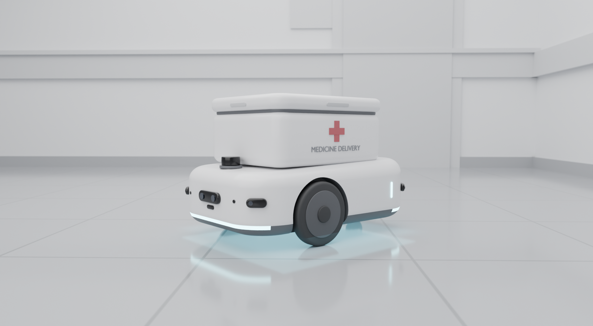
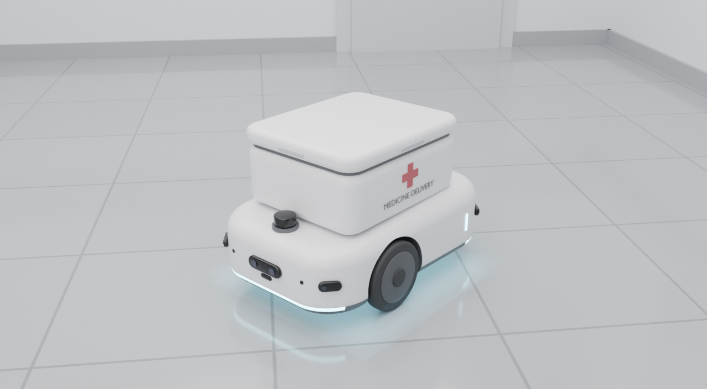
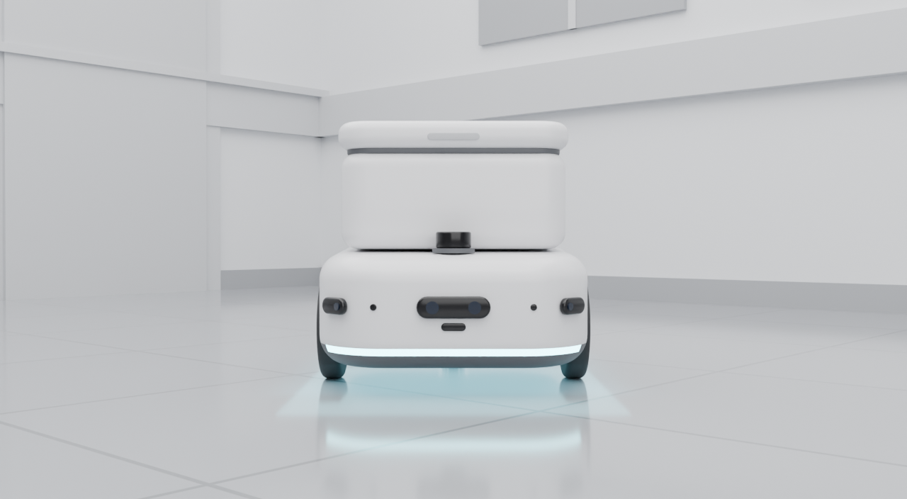
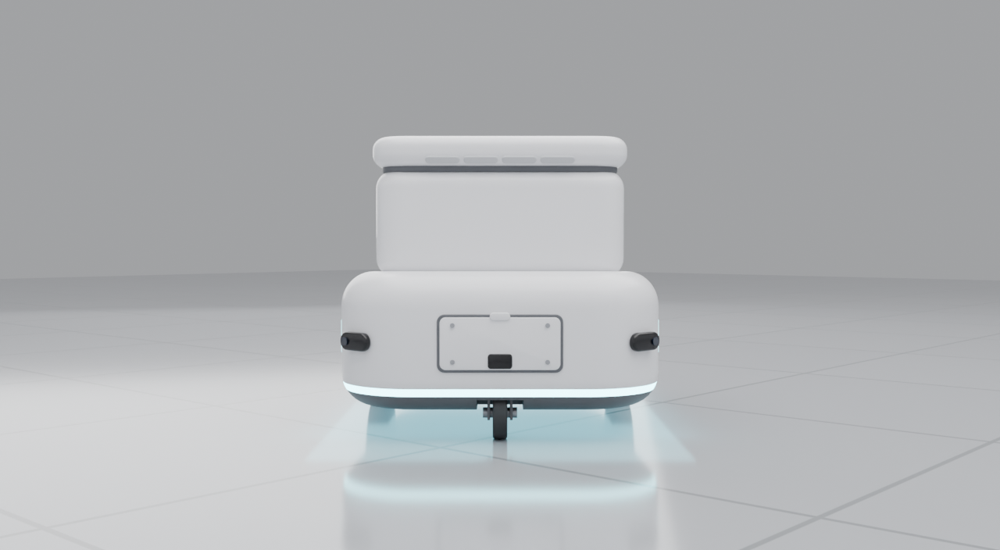
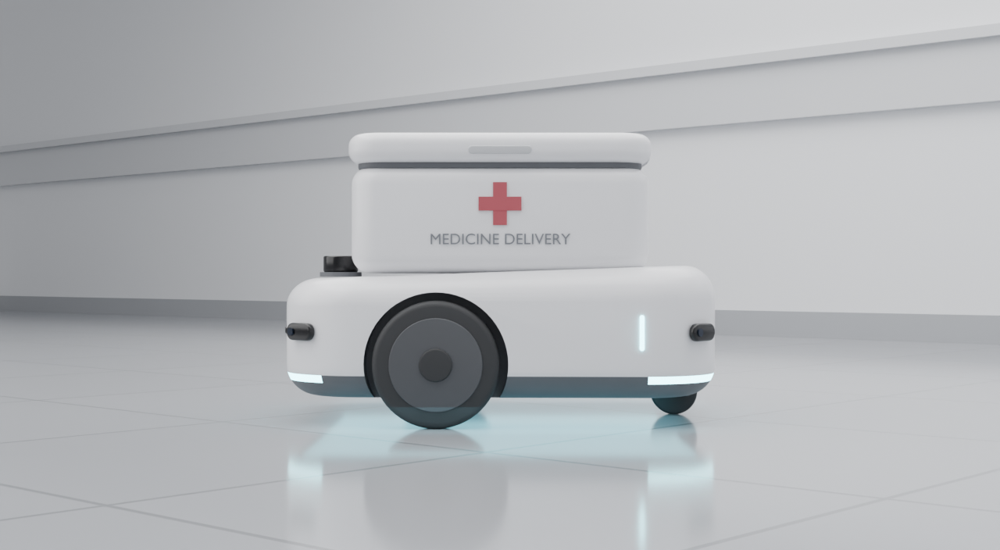
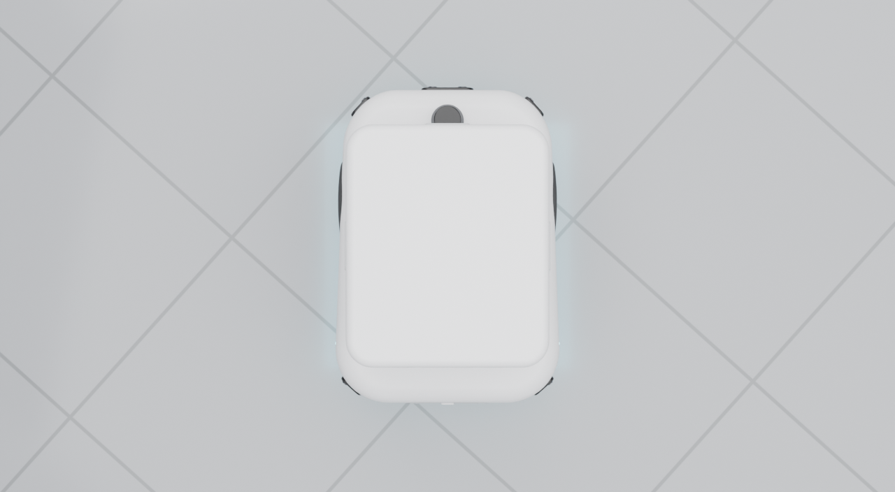
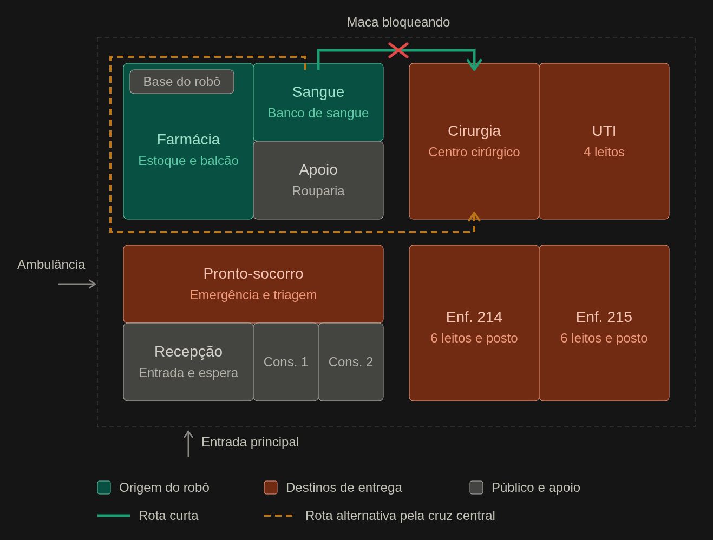
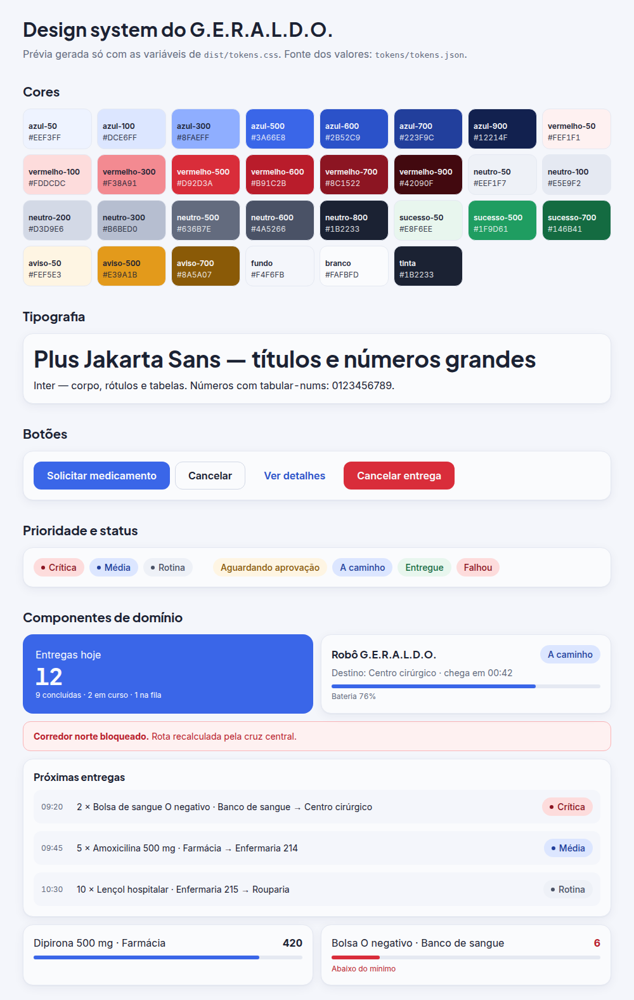

<h1 align="center">G.E.R.A.L.D.O.</h1>

<p align="center">
  <b>G</b>estor de <b>E</b>ntregas e <b>R</b>eposição <b>A</b>utônoma para <b>L</b>eitos e <b>D</b>ispensação <b>O</b>timizada
</p>

<p align="center">
  
</p>

# O que significa G.E.R.A.L.D.O.?

| Letra | Significa | No projeto |
|---|---|---|
| **G** | **G**estor | O sistema gerencia a logística, não só o movimento do robô |
| **E** | de **E**ntregas | Pedidos de medicamentos e insumos, com prioridade |
| **R** | e **R**eposição | O estoque é atualizado conforme o robô transporta |
| **A** | **A**utônoma | O robô navega sozinho e desvia de pessoas e macas |
| **L** | para **L**eitos | Enfermarias, UTI, centro cirúrgico, consultórios |
| **D** | e **D**ispensação | A partir da farmácia e do banco de sangue |
| **O** | **O**timizada | Fila por prioridade e rotas alternativas |

O nome resume o escopo: o G.E.R.A.L.D.O. não é apenas um veículo, é uma **plataforma completa de gerenciamento logístico de saúde**.

# Sobre o projeto

O ambiente hospitalar exige precisão e confiabilidade ininterruptas. O transporte manual de medicamentos entre a farmácia central e os leitos consome tempo valioso da equipe de enfermagem e está sujeito a erros operacionais.

O G.E.R.A.L.D.O. propõe uma solução integrada: um **robô móvel autônomo**, simulado no Gazebo, que leva medicamentos e insumos até os destinos e, ao fazer isso, **atualiza automaticamente o estoque** do hospital. Os profissionais pedem o que precisam do próprio consultório, pelo computador ou pelo celular, e acompanham a entrega até confirmar o recebimento.

É o **Projeto Tech Integrador** (IMR ExpoTech 2026), que une quatro disciplinas em um único fluxo de dados. A demonstração será na **ExpoTech, no sábado 28/11/2026**.

# O robô

<p align="center">
  
</p>

| | |
|---|---|
| **Locomoção** | Tração diferencial: 2 rodas de 20 cm nas laterais, embutidas no chassi, e 1 rodízio traseiro |
| **Tamanho** | 0,70 × 0,50 m, 0,47 m de altura |
| **Carga** | Baú de 0,48 × 0,40 m com tampa; a tampa só libera quando o solicitante confirma o recebimento |
| **Sensores** | LiDAR 2D, 5 sensores de proximidade (frente a 0° e ±45°, traseira a ±135°) e câmera RGB-D frontal |
| **Status** | Filete de LED na base (direção, bateria, modo de segurança) |

<table>
  <tr>
    <td align="center"><br><sub>Frente: câmera, sensores e LED</sub></td>
    <td align="center"><br><sub>Traseira: painel de manutenção e rodízio</sub></td>
  </tr>
  <tr>
    <td align="center"><br><sub>Lateral: roda de tração embutida</sub></td>
    <td align="center"><br><sub>Topo: baú e LiDAR</sub></td>
  </tr>
</table>

Os arquivos do modelo estão em [`modelos-3d/`](modelos-3d/).

# O hospital

<p align="center">
  
</p>

Um hospital inventado, de **um andar (46 × 30 m)**, desenhado para a simulação:

- **Origens do robô:** farmácia central (estoque e balcão de dispensação, com a base de carga) e banco de sangue.
- **Destinos:** centro cirúrgico, UTI (4 leitos), pronto-socorro, duas enfermarias (12 leitos), dois consultórios e a rouparia.
- **Recepção** na entrada principal, com pessoas circulando como obstáculos.
- **Corredores de 2 m** formam um anel e uma cruz central, então sempre existe mais de uma rota.

Na demonstração, uma maca bloqueia o corredor norte (rota curta) e o robô **recalcula pela cruz central** (rota alternativa, tracejada).

# Design system

<p align="center">
  
</p>

Visual **clínico e limpo**, de base branca, azul e vermelha (sem branco nem preto puros). O **azul** é a ação e a identidade; o **vermelho** é reservado ao que exige atenção imediata (prioridade crítica, perigo, estoque abaixo do mínimo). Os valores vivem em um único arquivo, [`tokens.json`](design-system/tokens/tokens.json), que gera o CSS, o preset do Tailwind e as cores do Unity.

- [Guia de referência](design-system/DESIGN_SYSTEM.md): as 9 regras de ouro, como usar os tokens e a lista de componentes.
- [Especificação completa](docs/superpowers/specs/2026-11-05-geraldo-design-system-design.md).
- [Prévia ao vivo](design-system/preview.html): abra no navegador.

# Como funciona uma entrega

```
Pedido no sistema web → Autenticação (JWT) → Fila de prioridade → Reserva de estoque
 → Despacho ao robô → Navegação com desvio de obstáculos → Chegada
 → Solicitante confirma o recebimento (a tampa libera) → Baixa e crédito de estoque
```

| Prioridade | Exemplo | Comportamento do robô | Validação |
|---|---|---|---|
| **Crítica** | Bolsas de sangue, drogas de emergência | Rota mais curta; desvio mais agressivo de áreas movimentadas | Token JWT + assinatura dupla do farmacêutico |
| **Média** | Antibióticos e fluidos para as enfermarias | Navegação padrão; aguarda liberação de corredores estreitos | Token JWT do setor solicitante |
| **Rotina** | Coleta de inventário obsoleto, lençóis | Só em horário de baixo pico; cede passagem a pessoas | Registro em log; permissões de baixo nível |

O estoque nunca é editado diretamente: cada reserva, baixa, crédito e estorno vira um registro imutável (`Movimentação`), o que torna o histórico auditável.

# As quatro frentes

| Disciplina | No projeto |
|---|---|
| **Intelligent Mobile Robots (IMR)** | O núcleo de mobilidade: robô simulado no Gazebo, navegação com Nav2, odometria e sensores simulados |
| **Programming Paradigms** | Backend em Python: padrão *Command*, fila de prioridade, estoque e gestão hospitalar |
| **Modelagem 3D, VR e AR** | O modelo do robô e o hospital; sistema web responsivo e, como extra, o cockpit 3D em Unity |
| **Intrusion Test (Pentest)** | Auditoria da API de despacho: requisição falsificada, JWT adulterado, escalada de papel, injeção; mitigação e relatório |

## Tecnologias

Python · FastAPI · ROS 2 (Jazzy) · Gazebo (Harmonic) · Nav2 · SQLite · JWT · React + Vite + TypeScript + Tailwind · Blender · Unity (extra) · GitHub Actions

> A stack acima é a **planejada**. Versões do ROS 2 e do Gazebo serão confirmadas com a disciplina, e a stack web será confirmada pelo grupo.

# Status

| | |
|---|---|
| ✅ Pronto | Especificações, planos de implementação, modelo 3D V1, planta do hospital e design system v0 (tokens, guia e prévia) |
| 🔧 Em andamento | **Semana 1 (05 a 11/11):** repositório, contratos, simulação, backend, sistema web, CI |
| 🎯 Marcos | **M1 (11/11)** um pedido na API vira meta no Nav2 e o robô anda no Gazebo · **M2 (18/11)** entrega completa, com o estoque mudando por causa do robô · **M3 (25/11)** demonstração congelada · **28/11** ExpoTech |

# Estrutura do repositório

```
geraldo/
├── README.md
├── modelos-3d/          # modelo do robô (.blend, .glb, script e renders)
├── design-system/       # tokens, guia de referência e prévia visual
│   ├── tokens/          # tokens.json (fonte única) e o gerador
│   ├── dist/            # tokens.css, preset do Tailwind e cores do Unity (gerados)
│   └── tests/           # testes dos tokens e do contraste
├── tools/               # utilitários e testes da raiz
├── docs/
│   ├── img/             # imagens da documentação
│   └── superpowers/
│       ├── specs/       # especificações (plano de desenvolvimento e design system)
│       └── plans/       # planos de implementação da semana 1, um por pessoa
└── (a seguir)           # hospital/, ros2_ws/, backend/, web/, security/, unity/
```

# Documentação

- [Especificação do plano de desenvolvimento](docs/superpowers/specs/2026-11-05-geraldo-plano-desenvolvimento-design.md): escopo, equipe, hospital, funções, contratos e cronograma.
- [Especificação do design system](docs/superpowers/specs/2026-11-05-geraldo-design-system-design.md): cores, tipografia e componentes.
- [Guia do design system](design-system/DESIGN_SYSTEM.md): regras de ouro e como usar os tokens.
- [Planos da semana 1](docs/superpowers/plans/README.md): ordem de execução e o plano de cada pessoa.

# Equipe

| Integrante | Frente |
|---|---|
| Samuel Solano Neres | **Líder.** Robô, simulação, hospital, contratos e integração |
| Erik Wesley Pereira do Nascimento | Backend e gestão hospitalar |
| Matheus Vieira Leite | Sistema web responsivo |
| Pedro de Oliveira Britto | Qualidade e segurança (CI, testes e pentest) |

# Como contribuir

1. Abra o plano da sua frente em [`docs/superpowers/plans/`](docs/superpowers/plans/README.md) e siga as tarefas na ordem.
2. Trabalhe em um branch `feat/<frente>-<assunto>` e abra um Pull Request.
3. Mudou um contrato (API, ROS, JWT)? Abra o PR e avise o dono da frente afetada: **contrato primeiro**.
4. Toda tarefa termina com testes passando e um commit pequeno, com mensagem em português.
