<p align="center">
  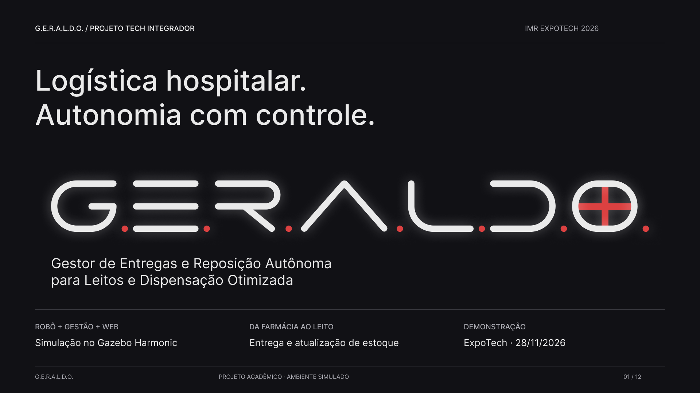
</p>

<h1 align="center">G.E.R.A.L.D.O.</h1>

<p align="center">
  <b>G</b>estor de <b>E</b>ntregas e <b>R</b>eposição <b>A</b>utônoma para <b>L</b>eitos e <b>D</b>ispensação <b>O</b>timizada
</p>

<p align="center">
  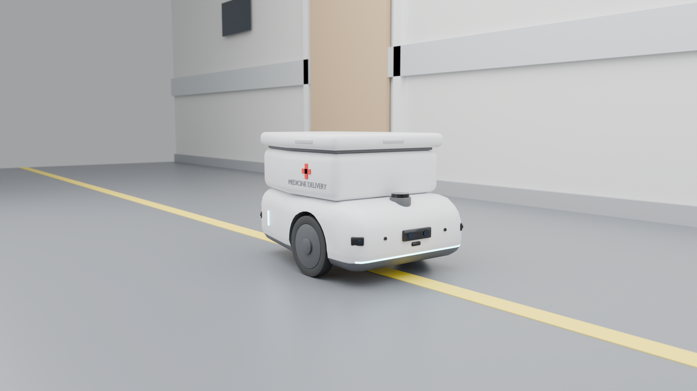
</p>

Um robô hospitalar autônomo, simulado no Gazebo, que leva medicamentos e insumos da farmácia e do banco de sangue até os leitos e **atualiza o estoque** do hospital conforme transporta. Os profissionais pedem pelo navegador, no computador ou no celular, e acompanham a entrega até confirmar o recebimento.

# O que é

O ambiente hospitalar exige precisão e confiabilidade ininterruptas. O transporte manual de medicamentos entre a farmácia central e os leitos consome tempo valioso da equipe de enfermagem e está sujeito a erros operacionais.

O G.E.R.A.L.D.O. propõe uma solução integrada: um **robô móvel autônomo** que navega sozinho e desvia de obstáculos, um **backend** que cuida de pedidos, prioridades e estoque, e um **sistema web** para pedir, aprovar e acompanhar. O nome resume o escopo: não é só um veículo, é uma plataforma de gerenciamento logístico de saúde.

É o **Projeto Tech Integrador** (IMR ExpoTech 2026), que une quatro disciplinas em um único fluxo de dados: robôs móveis inteligentes, paradigmas de programação, modelagem 3D e testes de intrusão. A demonstração será na **ExpoTech, no sábado 28/11/2026**.

| Letra | Significa | No projeto |
|---|---|---|
| **G** | **G**estor | O sistema gerencia a logística, não só o movimento do robô |
| **E** | de **E**ntregas | Pedidos de medicamentos e insumos, com prioridade |
| **R** | e **R**eposição | O estoque é atualizado conforme o robô transporta |
| **A** | **A**utônoma | O robô navega sozinho e desvia de pessoas e macas |
| **L** | para **L**eitos | Enfermarias, UTI, centro cirúrgico, consultórios |
| **D** | e **D**ispensação | A partir da farmácia e do banco de sangue |
| **O** | **O**timizada | Fila por prioridade e rotas alternativas |

# O robô

<p align="center">
  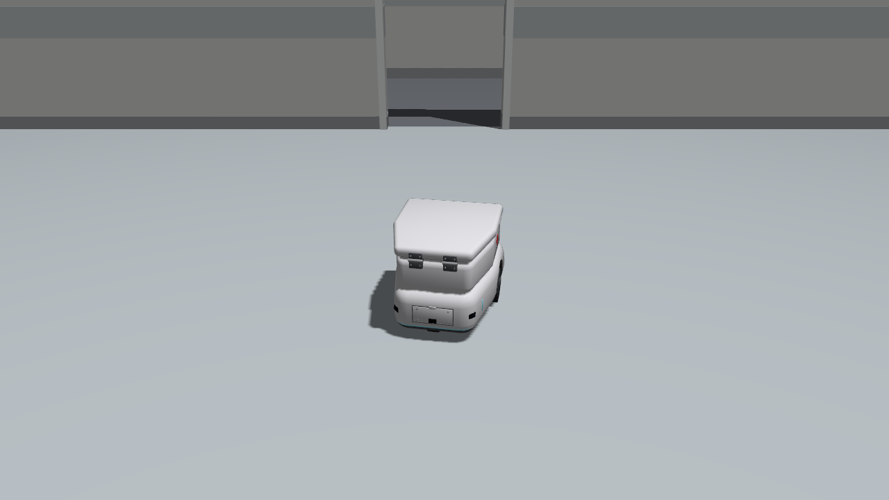
</p>

O robô é o **G.E.R.A.L.D.O. V3**, modelado no Blender ([`modelos-3d/geraldoV3.blend`](modelos-3d/geraldoV3.blend)) e simulado no **Gazebo Harmonic**. As malhas do simulador saem desse mesmo arquivo.

| | |
|---|---|
| **Locomoção** | Tração diferencial: 2 rodas de 0,20 m nas laterais, embutidas no chassi, e 1 rodízio traseiro articulado |
| **Tamanho** | Chassi de 0,70 × 0,50 m e 0,47 m de altura; massa simulada de 25 kg |
| **Carga** | Baú com tampa; a tampa só libera quando o solicitante confirma o recebimento |
| **LiDAR 2D** | Alcance de 0,12 a 12 m, campo de visão de ~172° (o baú bloqueia a visão para trás), 10 Hz |
| **Proximidade** | 5 sensores de alcance de até 2 m: frente a 0° e ±45°, traseira a ±135° |
| **Câmera** | RGB-D frontal, 320 × 240, campo de visão de 69°, 10 Hz |
| **Status** | Filete de LED na base |

**Navegação.** O robô usa **ROS 2 Jazzy** e o **Nav2**: localização com **AMCL** sobre o mapa do hospital, planejamento global com NavFn e controle local com **MPPI**, com costmaps global e local alimentados pelo LiDAR. Os 10 pontos de parada do hospital (farmácia, banco de sangue, consultórios, enfermarias, UTI, centro cirúrgico, pronto-socorro e rouparia) vêm da planta; uma varredura (`robot/scripts/nav_goal_sweep.py`) confere que o robô chega a todos.

**Velocidade por prioridade.** O perfil de navegação segue a prioridade da entrega:

| Prioridade | Velocidade máxima |
|---|---|
| Crítica | 1,0 m/s |
| Média | 0,8 m/s |
| Rotina | 0,5 m/s |

**Desvio de obstáculos.** O LiDAR é comparado com o mapa estático: o que não está no mapa (uma maca no corredor, por exemplo) vira obstáculo na telemetria e no costmap, e o Nav2 **replaneja**. Na demonstração, uma maca bloqueia o corredor norte (rota curta) e o robô recalcula pela cruz central.

**Parada de emergência.** O botão do Painel (papéis `admin` e `farmaceutico`) chama o backend, o robô consulta o estado e para em até uns 2 s; ao liberar, ele refaz a mesma meta. Há também o tópico ROS `/geraldo/estop`, para quem está na máquina.

**Dispatcher.** O pacote [`geraldo_dispatcher`](robot/ros2_ws/src/geraldo_dispatcher/) liga o backend ao Nav2: entra com o usuário `robo`, pede a próxima tarefa, manda as metas, envia eventos e telemetria (pose, rota, obstáculos e bateria virtual, a cada segundo) e conduz uma máquina de estados:

| Estado | O que o robô faz |
|---|---|
| `IDLE` | Esperando tarefa na base |
| `A_CAMINHO` | Indo à origem ou ao destino |
| `CARREGANDO` | Na origem, até a carga ser trancada |
| `CHEGOU` | No destino |
| `AGUARDANDO_RETIRADA` | Esperando o solicitante confirmar o recebimento |
| `VOLTANDO` | Retornando à base |
| `PARADA_EMERGENCIA` | Parado por emergência |

A sequência completa, com as chamadas à API e as falhas possíveis, está em [`docs/contracts/robot-protocol.md`](docs/contracts/robot-protocol.md). As velocidades e o comportamento medidos na simulação estão no [relatório de medições](docs/superpowers/plans/2026-11-13-semana3-1-medicoes.md).

### As vistas do V3

<table>
  <tr>
    <td align="center">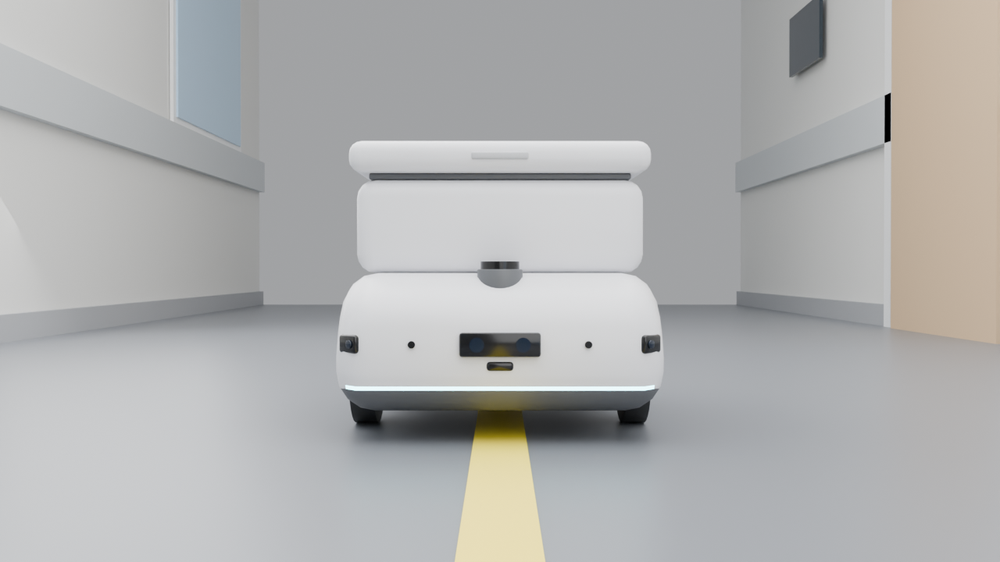<br><sub>Frente: câmera, sensores e LED</sub></td>
    <td align="center">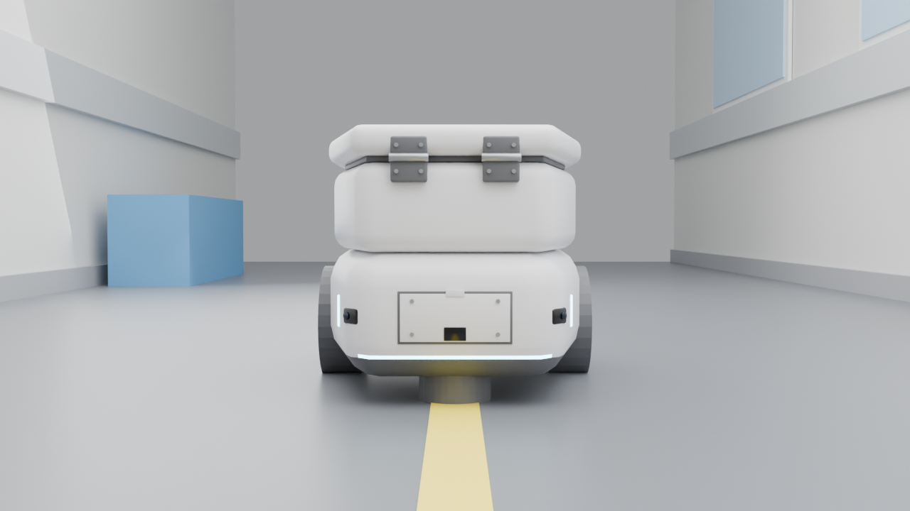<br><sub>Traseira: painel de manutenção, rodízio e dobradiças</sub></td>
  </tr>
  <tr>
    <td align="center">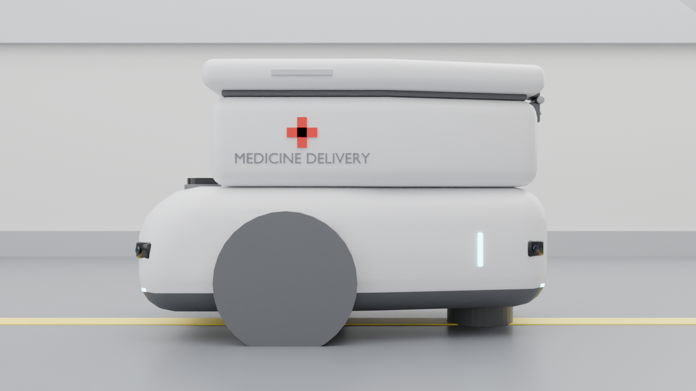<br><sub>Lateral: roda de tração embutida</sub></td>
    <td align="center">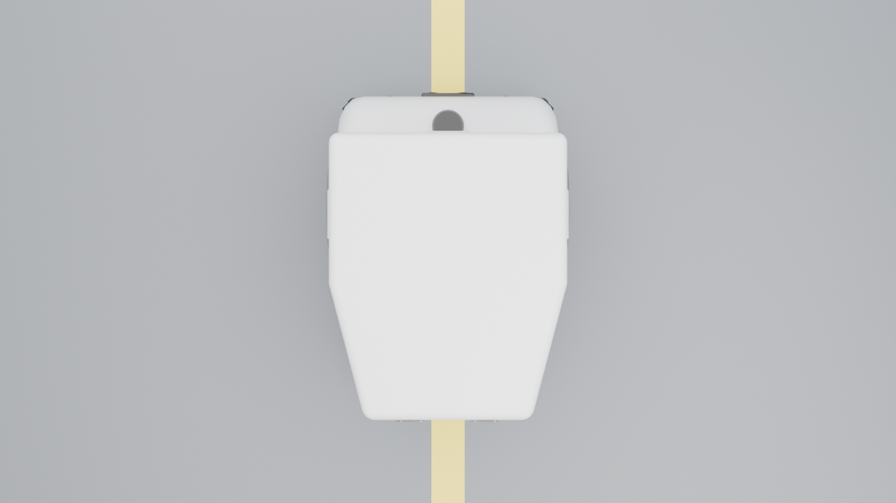<br><sub>Topo: baú e LiDAR</sub></td>
  </tr>
  <tr>
    <td colspan="2" align="center">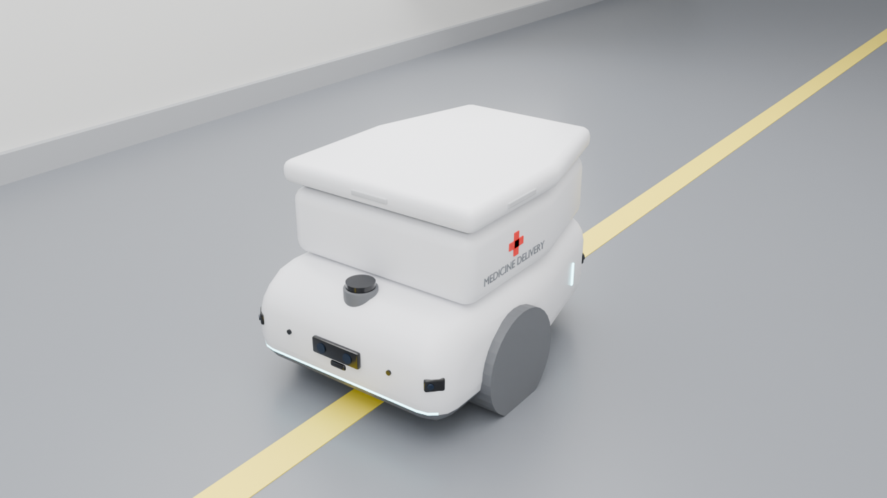<br><sub>Vista aérea</sub></td>
  </tr>
</table>

Medidas, arquivos e como renderizar: [`modelos-3d/`](modelos-3d/). A primeira versão do modelo ficou em [`modelos-3d/v1/`](modelos-3d/v1/).

# O hospital

<p align="center">
  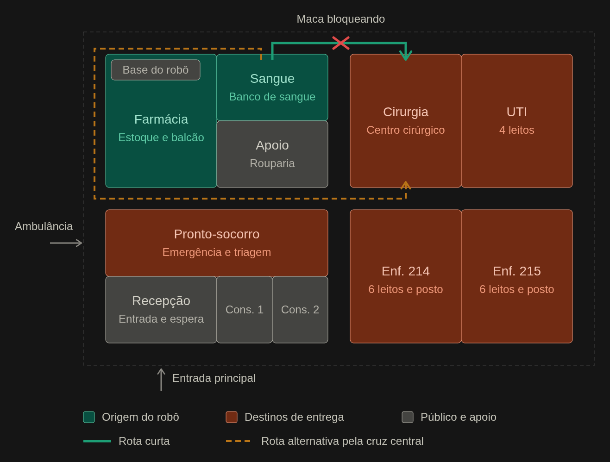
</p>

Um hospital inventado, de **um andar (46 × 30 m)**, desenhado para a simulação:

- **Origens do robô:** farmácia central (estoque, balcão de dispensação e a base) e banco de sangue.
- **Destinos:** centro cirúrgico, UTI, pronto-socorro, duas enfermarias, dois consultórios e a rouparia (apoio).
- **Recepção** na entrada principal.
- **Corredores de 2 m** formam um anel e uma cruz central, então sempre existe mais de uma rota.

A planta é a fonte única ([`robot/hospital/hospital.yaml`](robot/hospital/hospital.yaml)): dela saem o mundo do Gazebo, o mapa do Nav2 e os pontos de parada.

<p align="center">
  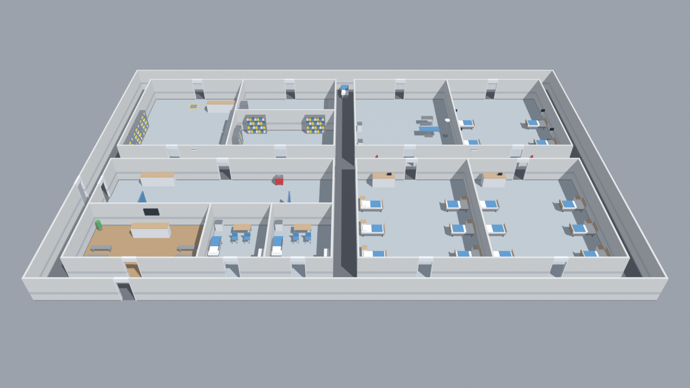
</p>

# O sistema web

Aplicação responsiva (funciona no celular), em português, com login e papéis. O que cada um vê:

| Papel | Telas |
|---|---|
| Médico e enfermeiro | **Solicitar**, **Minhas entregas** e **Painel** |
| Farmacêutico e admin | As anteriores e **Farmácia**: **Aprovações** (só o farmacêutico aprova ou recusa; o admin só acompanha) e **Estoque** (saldos e histórico) |

<table>
  <tr>
    <td align="center">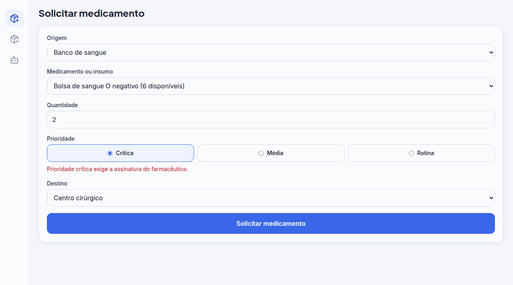<br><sub>Solicitar: o pedido, com prioridade</sub></td>
    <td align="center">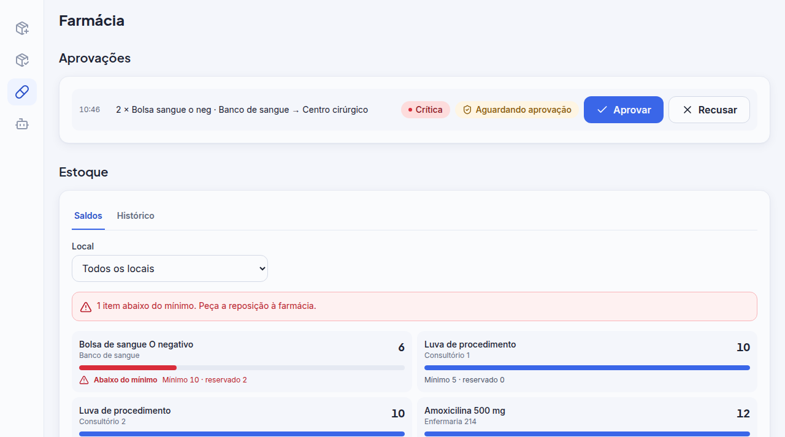<br><sub>Farmácia: um crítico esperando aprovação</sub></td>
  </tr>
  <tr>
    <td colspan="2" align="center">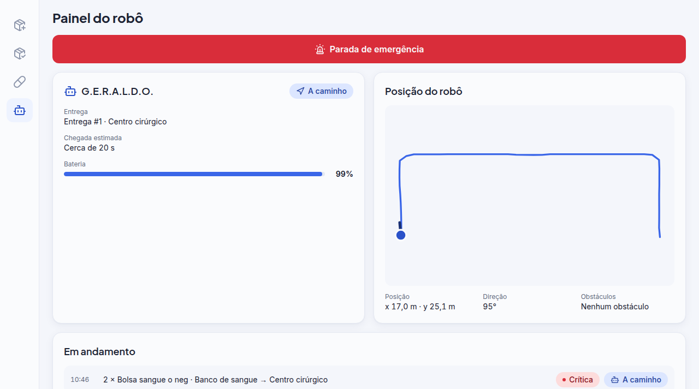<br><sub>Painel: o robô andando, com rota, fila e botão de emergência</sub></td>
  </tr>
</table>

# Como funciona uma entrega

<p align="center">
  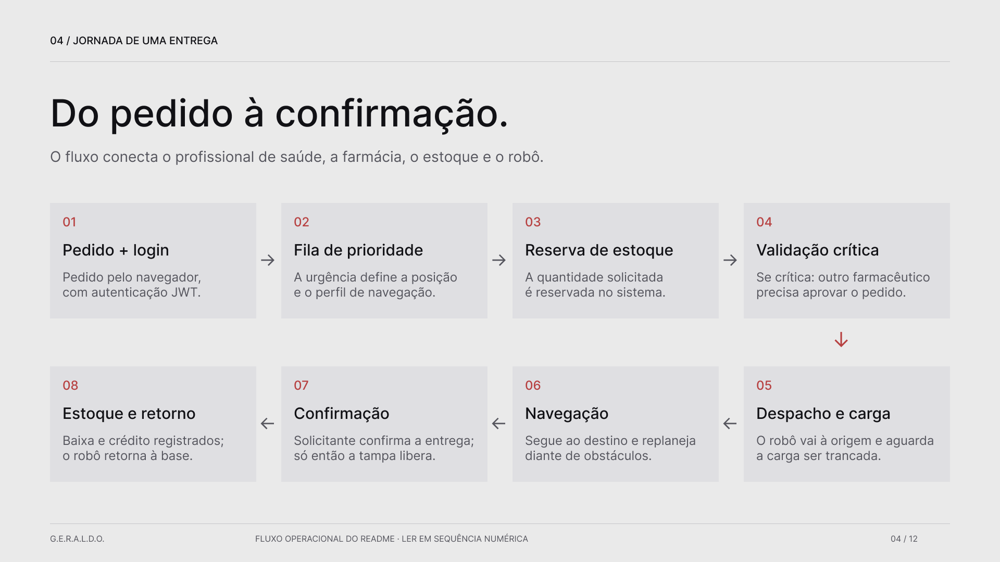
</p>

| Prioridade | Exemplo | Robô | Validação |
|---|---|---|---|
| **Crítica** | Bolsas de sangue, drogas de emergência | 1,0 m/s | **Assinatura dupla:** o pedido espera na aba Farmácia, e quem aprova é outro farmacêutico, nunca quem pediu. Se o farmacêutico recusar, informa o motivo e o solicitante o lê em Minhas entregas |
| **Média** | Antibióticos e fluidos para as enfermarias | 0,8 m/s | Token JWT do setor solicitante |
| **Rotina** | Coleta de inventário obsoleto, lençóis | 0,5 m/s | Só sai da fila em horário de baixo pico |

O estoque nunca é editado diretamente: cada reserva, baixa, crédito e estorno vira um registro imutável (`Movimentação`), o que torna o histórico auditável. Uma recusa devolve a reserva com um estorno.

# Arquitetura

<p align="center">
  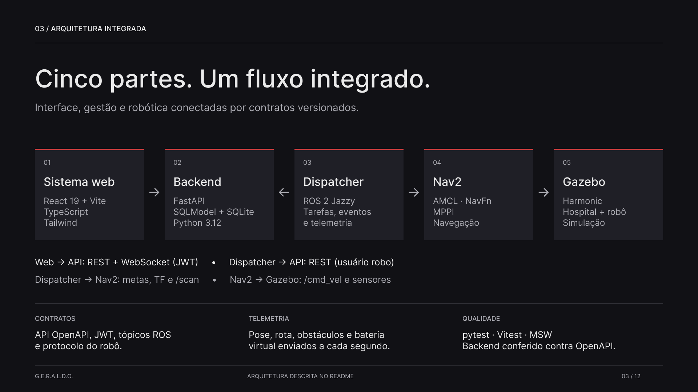
</p>

As peças conversam por contratos versionados em [`docs/contracts/`](docs/contracts/): a API em [`openapi.yaml`](docs/contracts/openapi.yaml), o login em [`jwt.md`](docs/contracts/jwt.md), os tópicos ROS em [`ros-interfaces.md`](docs/contracts/ros-interfaces.md) e a conversa do robô com o backend em [`robot-protocol.md`](docs/contracts/robot-protocol.md). Mudou o contrato, mudam os testes: o backend é conferido contra o OpenAPI.

# Como rodar a demo

**Pré-requisitos:** Linux (testado no Pop!_OS 24.04), **ROS 2 Jazzy** e **Gazebo Harmonic** instalados, Python 3.12 e Node.js.

**Primeira vez:**

```bash
(cd backend && python3 -m venv .venv && .venv/bin/pip install -r requirements.txt)
(cd web && npm install)
source /opt/ros/jazzy/setup.bash && (cd robot/ros2_ws && colcon build --symlink-install)
```

**Subir tudo** (backend, web, Gazebo, Nav2 e dispatcher; Ctrl+C derruba):

```bash
source /opt/ros/jazzy/setup.bash && source robot/ros2_ws/install/setup.bash
bash robot/scripts/demo.sh
```

Abra <http://localhost:5173> e entre com um dos usuários de demonstração (senha `demo`, uma senha de demonstração **local**, nunca use fora daqui):

| Usuário | Papel |
|---|---|
| `medico1` | Médico (Consultório 1) |
| `farmaceutico1` e `farmaceutico2` | Farmacêuticos: o crítico pedido por um é aprovado pelo outro |
| `admin` | Administrador |

Roteiro: entre como `medico1`, peça uma entrega **crítica**, aprove em **Farmácia** como `farmaceutico1` e veja o robô sair no Gazebo e no Painel. O passo a passo da apresentação, com a maca e a parada de emergência, está em [`docs/demo-roteiro.md`](docs/demo-roteiro.md). `bash robot/scripts/demo.sh --headless` sobe sem a janela do Gazebo.

**Testes:**

```bash
(cd backend && .venv/bin/python -m pytest)
(cd web && npm test -- --run && npm run build)
python3 -m pytest tools robot -q      # com o ROS carregado
```

# A marca

O logotipo é um traço contínuo de espessura única, com pontos vermelhos entre as letras. No **O** final, uma cruz vermelha faz a ligação com o universo hospitalar.

<table>
  <tr>
    <td align="center">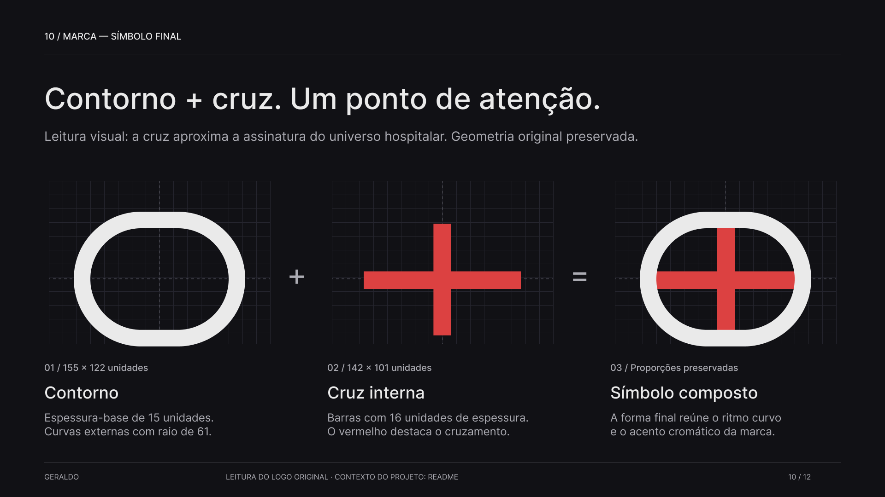</td>
    <td align="center">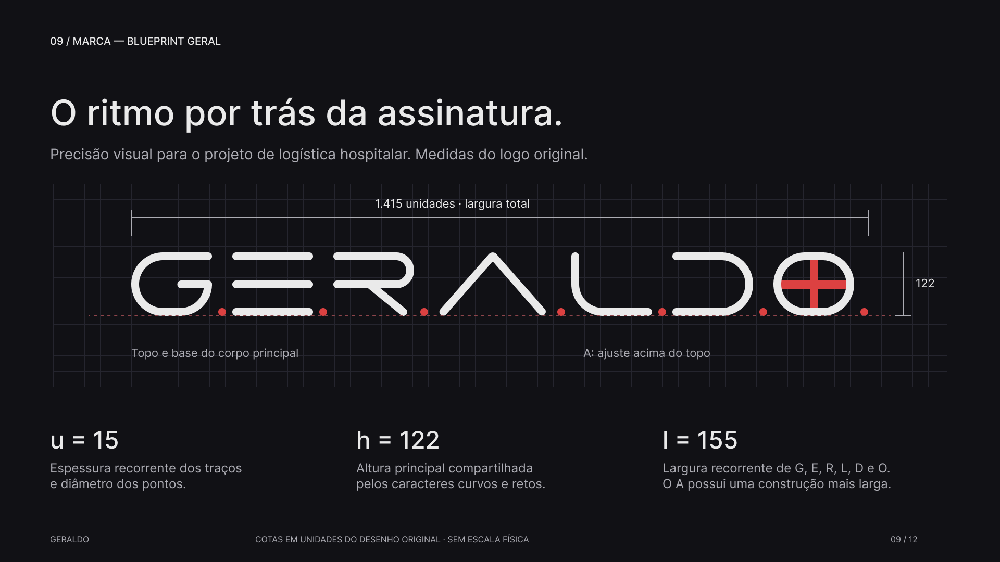</td>
  </tr>
</table>

As cores e a tipografia da interface saem dos tokens do [design system](design-system/DESIGN_SYSTEM.md).

# Tecnologias

Python 3.12 · FastAPI · SQLModel e SQLite · JWT · ROS 2 Jazzy · Gazebo Harmonic · Nav2 (AMCL, NavFn, MPPI) · React 19 + Vite + TypeScript + Tailwind · Vitest e MSW · Blender 5.2

# Estrutura do repositório

```
geraldo/
├── backend/             # API FastAPI: pedidos, prioridades, estoque, JWT, telemetria
├── web/                 # sistema web responsivo (React + Vite)
├── robot/
│   ├── hospital/        # hospital.yaml (fonte única) e o gerador do mundo, mapa e pontos de parada
│   ├── scripts/         # demo.sh, parâmetros do Nav2, medições, varredura dos pontos, API falsa
│   └── ros2_ws/src/     # geraldo_description, geraldo_nav e geraldo_dispatcher
├── modelos-3d/          # robô V3 e maquete do hospital (Blender), renders; v1/ é a primeira versão
├── design-system/       # tokens, guia de referência e prévia visual
├── docs/
│   ├── contracts/       # contratos: API, ROS, JWT e protocolo do robô
│   ├── img/             # imagens da documentação
│   └── superpowers/     # especificações e planos de implementação
├── security/            # escopo e ataques do teste de intrusão
├── unity/               # cockpit 3D (extra, ainda não começou)
└── tools/               # testes e utilitários do repositório (contratos, layout, robô de mentira)
```

# Documentação

- [Roteiro da demo](docs/demo-roteiro.md): o passo a passo da apresentação.
- [Contratos](docs/contracts/): API, ROS, JWT e o protocolo do robô.
- [Padrões de projeto](docs/padroes-de-projeto.md): SOLID, Factory, Strategy, Observer, Adapter e injeção de dependência, o padrão de código de todas as frentes.
- [Guia do design system](design-system/DESIGN_SYSTEM.md) e [prévia ao vivo](design-system/preview.html): cores, tipografia e componentes.
- [Relatório de medições do robô](docs/superpowers/plans/2026-11-13-semana3-1-medicoes.md): velocidade de cruzeiro, frenagem, parada de emergência e varredura dos pontos, medidas na simulação.
- **Para a equipe:** as regras de trabalho estão em [`AGENTS.md`](AGENTS.md) (e no `AGENTS.md` de cada pasta); especificações e planos ficam em [`docs/superpowers/`](docs/superpowers/).

# Status

| | |
|---|---|
| ✅ Entregue | **Semanas 1 a 3:** contratos, hospital e robô simulados, navegação com desvio de obstáculos, dispatcher, backend completo, sistema web completo (com a aba Farmácia) e design system |
| 🔧 Em andamento | App instalável (ponte ROS, orquestrador e visão 2D), em desenvolvimento pelo Erik · teste de intrusão da API, pelo Pedro |
| 🎯 Próximo | Demonstração congelada e a **ExpoTech, em 28/11/2026** |

# Equipe

| Integrante | Frente |
|---|---|
| Samuel Solano Neres | **Líder.** Robô, simulação, hospital, contratos e integração |
| Erik Wesley Pereira do Nascimento | Backend e gestão hospitalar |
| Matheus Vieira Leite | Sistema web responsivo |
| Pedro de Oliveira Britto | Qualidade e segurança (testes e pentest) |
