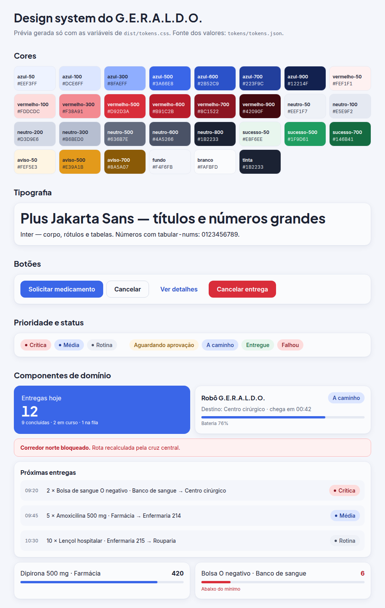

# Design system do G.E.R.A.L.D.O.

Guia de referência para pessoas e IAs. A especificação completa (todas as tabelas) está em
`docs/superpowers/specs/2026-11-05-geraldo-design-system-design.md`; os valores vivem em
`design-system/tokens/tokens.json`, que é a **fonte única**.

Direção: clínica, limpa e confiável. Base branca, azul e vermelha. Cards brancos de 16 px sobre fundo claro;
a hierarquia vem de tamanho e peso, não de cor.

## Prévia

Para ver ao vivo, abra [`preview.html`](preview.html) no navegador (ela lê só as variáveis de `dist/tokens.css`).

## Regras de ouro

1. **Sem hex solto.** Cor sempre via token (classe do preset ou `var(--azul-500)`). Exceção: SVG e canvas, importando de `tokens.css` ou do JS gerado.
2. **Vermelho só para:** prioridade crítica, perigo, parada de emergência, estoque abaixo do mínimo e erro. Nunca para decoração nem para ação primária.
3. **Um botão primário por tela ou seção.** Os demais são secundário ou fantasma.
4. **Status nunca só por cor.** Sempre cor mais ícone ou texto.
5. **Números com `tabular-nums`** (saldo, quantidade, horário, bateria, contagens).
6. **Mobile-first.** Escreva o layout do celular primeiro e amplie com os breakpoints.
7. **Alvo de toque mínimo de 44 × 44 px** em controles (`min-h-controle`, `min-w-controle`).
8. **Texto da interface em português**, em sentence case, botão com verbo curto ("Solicitar medicamento"), sem "por favor", sem ponto final em rótulos e títulos. Mensagem de erro diz o que houve e o que fazer.
9. **Nada de valores soltos de espaçamento:** só a escala de 4 px do Tailwind.

## De onde vêm os valores

| Arquivo | Para quê |
|---|---|
| `design-system/tokens/tokens.json` | Fonte única (edite só este) |
| `design-system/tokens/build.mjs` | Gera os três arquivos de `dist/` |
| `design-system/dist/tokens.css` | Variáveis CSS (`--azul-500`, `--radius-card`, `--shadow-card`...) |
| `design-system/dist/tailwind.preset.cjs` | Preset do Tailwind (cores, fontes, raios, sombras, breakpoints) |
| `design-system/dist/GeraldoTokens.cs` | Cores `Color32` para o Unity |
| `design-system/preview.html` e `preview.png` | Prévia visual (só variáveis do `tokens.css`) |

Depois de editar `tokens.json`: `node design-system/tokens/build.mjs && (cd design-system && node --test)`. Ninguém edita `dist/` à mão.

## Cores principais

| Papel | Token | Hex |
|---|---|---|
| Primária (ação, item ativo) | `azul-500` | `#3A66E8` |
| Alerta clínico | `vermelho-500` | `#D92D3A` |
| Fundo das telas | `fundo` | `#F4F6FB` |
| Cards, campos e texto sobre azul e vermelho | `branco` | `#FAFBFD` |
| Texto principal | `tinta` | `#1B2233` |

**Sem branco nem preto puros.** O `branco` do sistema é um off-white suave e o tom mais escuro é `neutro-900`; nenhuma cor da paleta é branco ou preto puro (garantido pelo teste `design-system/tests/palette.test.mjs`).

Escalas completas de azul, vermelho, neutro, sucesso e aviso: no `tokens.json`, na spec e na prévia acima.

## Prioridade, status e estoque

- **Prioridade:** `critica` = vermelho, `media` = azul, `rotina` = cinza. Nunca use âmbar para prioridade.
- **Status da entrega:** `PENDENTE_APROVACAO` (aviso), `NA_FILA` (neutro), `EM_ROTA` e `AGUARDANDO_RECEBIMENTO` (azul), `ENTREGUE` (sucesso), `CANCELADA` (neutro, riscado), `FALHOU` (vermelho). Sempre com ícone e texto.
- **Estoque:** acima de 120% do mínimo = azul; entre 100% e 120% = aviso; abaixo do mínimo = vermelho com o texto "Abaixo do mínimo".

## Forma

Cards `rounded-card` (16 px) com borda `border-neutro-100` e `shadow-card`; botões, campos e linhas de lista `rounded-controle` (12 px); selos `rounded-full`. Fontes: `font-display` (Plus Jakarta Sans) para títulos e números grandes; `font-sans` (Inter) para o resto.

## Componentes

**Base:** `Button` (primário, secundário, fantasma, perigo), `Input`/`Select`/`Textarea`, `Card`, `Badge`, `Tabs`, `Table`, `Dialog`, `Toast`, `EmptyState`, `Skeleton`, `Sidebar`/`BottomNav`/`TopBar`/`PageHeader`.

**De domínio:** `PriorityBadge`, `StatusBadge`, `StatCard`, `RobotStatusCard`, `DeliveryQueueRow`, `StockLevelBar`, `MovementLogRow`, `AlertBanner`, `TelemetryPanel`, `RequestForm`.

A especificação de cada um está na seção 10 e 11 da spec do design system. A implementação web fica em `web/src/components/`.

## Navegação

Abaixo de 768 px: barra inferior com 3 a 4 itens. A partir de 768 px: barra lateral de ícones de 72 px com o item ativo destacado. Conteúdo com no máximo 1280 px.

## Testes

`(cd design-system && node --test)` confere que os tokens geram os arquivos certos e que todos os pares de texto e fundo usados nos componentes passam de 4,5:1 de contraste.
