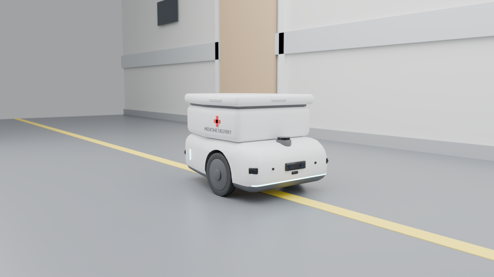

# Modelos 3D do G.E.R.A.L.D.O.

Versão atual: **V3**, a que o Gazebo usa. A V1 ficou em [`v1/`](v1/) como histórico; ela continua sendo o modelo do cockpit em Unity (`v1/geraldoV1.glb`).



## Arquivos

| Arquivo | Para quê |
|---|---|
| `geraldoV3.blend` | O robô V3, editável no Blender. As malhas do Gazebo saem dele (`robot/scripts/export_blender_mesh.py`); **não salve por cima** sem regenerar e conferir as malhas |
| `render_geraldoV3.py` | Monta o corredor, as luzes e as câmeras e renderiza as vistas em `renders/geraldoV3_<vista>.png`. Não salva o `.blend` |
| `renders/geraldoV3_*.png` | Vistas do V3: hero, frente, traseira, lateral, topo e aérea |
| `v1/` | A primeira versão (`geraldoV1.blend`, `geraldoV1.glb`, `build_geraldoV1.py` e os renders), mantida como histórico |

## Medidas

| | |
|---|---|
| Chassi | 0,70 × 0,50 m |
| Altura total | 0,47 m |
| Rodas de tração | 2, de 0,20 m de diâmetro; eixo em x = +0,10 m; separação de 0,45 m |
| Rodízio | 1 traseiro, de 0,08 m de diâmetro, com pivô e garfo |
| Baú | Tampa com dobradiças, cruz vermelha e alças; 0,58 × 0,48 m na tampa |
| Sensores | LiDAR 2D (frente do chassi), 5 de proximidade (0° e ±45° na frente; ±135° atrás), câmera RGB-D (frente) |

Convenções: unidades em metros; frente do robô = **+X**; eixo das rodas = **Y**; `base_link` no chão. Os nomes dos objetos seguem a convenção ROS.

## Como renderizar

Precisa do Blender 5.2. Da raiz do repositório:

```bash
blender -b modelos-3d/geraldoV3.blend --python modelos-3d/render_geraldoV3.py
```

Para algumas vistas: `VIEWS=hero,frente`. Para um teste rápido, em resolução baixa e fora do repositório: `PREVIEW=1 PREVIEW_DIR=/tmp`. O render completo leva alguns minutos (Cycles, em CPU).

## Observações

- O Gazebo **não usa o `.blend` direto**: usa as malhas OBJ exportadas dele e colisões simples (caixas e cilindros); ver `robot/AGENTS.md`.
- O `v1/build_geraldoV1.py` roda de dentro de qualquer pasta e escreve ao lado dele: `blender -b --python modelos-3d/v1/build_geraldoV1.py`.

## Hospital (maquete)

Maquete 3D do hospital, montada por script a partir da planta (`robot/hospital/hospital.yaml`): pisos por sala, paredes com rodapé e faixa de proteção, portas com batente, 93 peças de mobiliário (macas, leitos, bancos, balcões, estantes, equipamentos) e 4 obstáculos de corredor. Sem teto.

| Arquivo | Para quê |
|---|---|
| `hospital.blend` | Cena editável (coleções `HOSPITAL_estrutura`, `HOSPITAL_mobiliario`, `HOSPITAL_obstaculos`, `HOSPITAL_maca`) |
| `build_hospital.py` | Monta a cena a partir de `robot/hospital/hospital_layout.json`, salva o `.blend` e renderiza as vistas |
| `hospital_pecas.py` | Uma função de desenho por tipo de peça (tamanhos vêm de `robot/hospital/pieces.py`) |
| `hospital_paleta.py` | `PALETA`: todas as cores e materiais da maquete |
| `renders/hospital_*.png` | Vistas: aérea, topo, corredor e uma por zona |

Para regenerar: `blender -b --python build_hospital.py` (`VIEWS=aerea,uti` para algumas vistas, `NO_RENDER=1` para só montar). O Gazebo não usa o `.blend`: usa as malhas exportadas por `robot/scripts/export_hospital_mesh.py` (ver `robot/AGENTS.md`).
