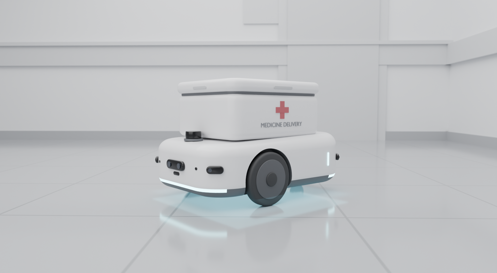

# Modelos 3D do G.E.R.A.L.D.O.

Versão atual: **V1**. Cada versão nova vira arquivos novos ao lado (`geraldoV2.*`); a V1 não é sobrescrita.



## Arquivos

| Arquivo | Para quê |
|---|---|
| `geraldoV1.blend` | Cena editável do Blender: o robô, o corredor de cenário e 6 câmeras (hero, frente, traseira, lateral, aérea, topo) |
| `geraldoV1.glb` | Só o robô, para o Unity e para a web |
| `build_geraldoV1.py` | Script que gera tudo (modelo, cenário, câmeras, renders e o `.glb`) |
| `renders/` | Imagens de referência de cada vista |

## Medidas

| | |
|---|---|
| Chassi | 0,70 × 0,50 m |
| Altura total | 0,47 m |
| Rodas de tração | 2, de 0,20 m de diâmetro; eixo em x = +0,10 m; separação de 0,45 m |
| Rodízio | 1 traseiro, de 0,08 m de diâmetro, embutido |
| Baú | 0,48 × 0,40 m, com tampa, cruz vermelha e dobradiças |
| Sensores | LiDAR 2D (topo), 5 de proximidade (0° e ±45° na frente; ±135° atrás), câmera RGB-D (frente) |

Convenções: unidades em metros; frente do robô = **+X**; eixo das rodas = **Y**; `base_link` no chão. Os nomes dos objetos seguem a convenção ROS (`base_link`, `roda_esq_link`, `roda_dir_link`...).

## Como regenerar

Precisa do Blender 5.2. Dentro desta pasta:

```bash
blender -b --python build_geraldoV1.py
```

Para renderizar só algumas vistas: `VIEWS=hero,frente blender -b --python build_geraldoV1.py`. Para um teste rápido sem salvar nada: `PREVIEW=1 PREVIEW_DIR=/tmp blender -b --python build_geraldoV1.py`.

## Observações

- O Gazebo **não usa o `.blend`**: usa uma malha exportada (OBJ) e uma colisão simples de 0,70 × 0,50 m. A exportação está no plano do robô (`docs/superpowers/plans/2026-11-05-semana1-samuel-robo.md`).
- O disco do LiDAR no topo é opcional; para tirá-lo, mude `LIDAR = True` para `False` no script e gere de novo.
- A altura segue as imagens de referência do projeto (0,47 m). A especificação textual sugeria 0,90 a 1,00 m; se o grupo decidir pela versão alta, ela entra como `geraldoV2`.

## Hospital (maquete)

Maquete 3D do hospital, montada por script a partir da planta (`robot/hospital/hospital.yaml`): pisos por sala, paredes com rodapé e faixa de proteção, portas com batente, 93 peças de mobiliário (macas, leitos, bancos, balcões, estantes, equipamentos) e 4 obstáculos de corredor. Sem teto.

| Arquivo | Para quê |
|---|---|
| `hospital.blend` | Cena editável (coleções `HOSPITAL_estrutura`, `HOSPITAL_mobiliario`, `HOSPITAL_obstaculos`, `HOSPITAL_maca`) |
| `build_hospital.py` | Monta a cena a partir de `robot/hospital/hospital_layout.json`, salva o `.blend` e renderiza as vistas |
| `hospital_pecas.py` | Uma função de desenho por tipo de peça (tamanhos vêm de `robot/hospital/pieces.py`) |
| `hospital_paleta.py` | `PALETA`: todas as cores e materiais da maquete |
| `renders/hospital_*.png` | Vistas: aérea, topo, corredor e uma por zona |

Para regenerar: `blender -b --python build_hospital.py` (`VIEWS=aerea,uti` para algumas vistas, `NO_RENDER=1` para só montar). O Gazebo não usa o `.blend`: usa as malhas exportadas por `robot/scripts/export_hospital_mesh.py` (ver `robot/AGENTS.md`).
